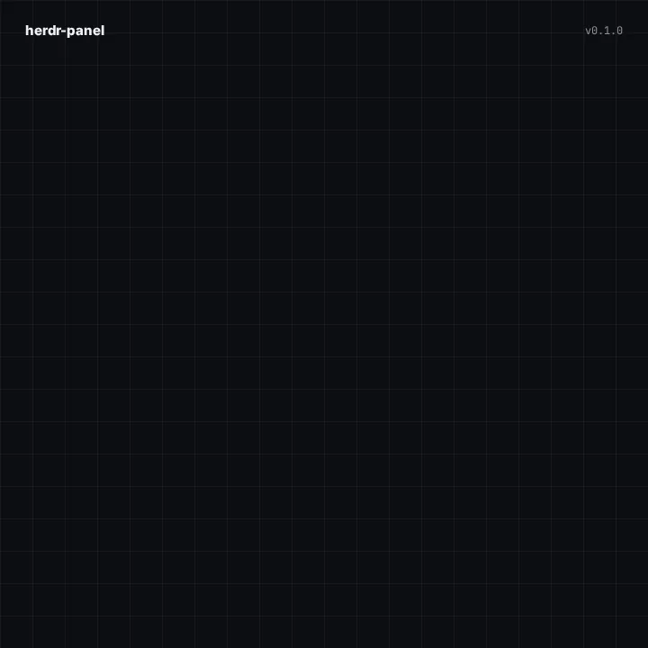

<p align="center"></p>

<h3 align="center">See which of your coding agents are working, finished or waiting on you, without switching to the terminal</h3>

<p align="center">herdr-panel puts <a href="https://herdr.dev">Herdr</a>'s agents sidebar in your desktop panel, starting with KDE Plasma. A dot on the panel icon shows the most urgent state across every agent you run. Click it for the full list: every agent in every local session and on every SSH machine, live.</p>

<p align="center"></p>

<p align="center"><a href="#install-in-two-steps"></a></p>

<p align="center"><sub>✓&nbsp;Free,&nbsp;MIT&nbsp;licensed &nbsp; ✓&nbsp;No&nbsp;dependencies&nbsp;beyond&nbsp;herdr&nbsp;and&nbsp;Plasma &nbsp; ✓&nbsp;KDE&nbsp;Plasma&nbsp;6&nbsp;today,&nbsp;more&nbsp;desktops&nbsp;coming</sub></p>

<br />

## Keep an eye on your agents from anywhere on your desktop

Herdr's sidebar tells you what every agent is doing, but only while you're looking at Herdr. herdr-panel shows the same thing in your panel, so you notice an agent that needs you while you're in your browser, editor or a meeting.

### 🟠 One dot for everything

The panel icon carries a single dot for the most urgent state across all your agents: **blocked** (red) → **working** (orange, pulsing) → **done** (blue, just finished and not looked at yet) → **idle** (green ring). An agent stays done until you focus it or it starts working again. Next to it, `3/9` counts the active agents out of the total. Hover for the breakdown: `2 working · 1 blocked · 0 done · 6 idle`.

### 📋 The sidebar, one click away

Click the icon for every agent, laid out like Herdr's own sidebar: `Local · workspace · title`, with the agent and its status underneath. Toggle **grouped** to sort them under their session and workspace, and **default** / **recent** to keep herdr's sidebar order or put the latest status change first. Click an agent to jump to it in herdr. The agent focused in Herdr is highlighted, and hovering a row shows its folder.

### 🛰️ Every session, every machine

herdr-panel reads every running local Herdr session and every enabled machine in `herdr machine list`. Local agents refresh every 2 seconds and machines every 20. A machine that can't be reached doesn't hold anything up. A quiet `1 machine couldn't connect` line appears at the bottom, and clicking it shows the reason.

## Works with your desktop

| Desktop / bar | Status |
|---|---|
| **KDE Plasma 6** | ✅ Panel widget |
| **Waybar** (Hyprland, Sway, niri…) | 🛠️ Planned |
| **GNOME Shell** | 💭 Ideas welcome |

Every frontend shares the same data script, [`core/herdr-snapshot.sh`](core/herdr-snapshot.sh), and the installer sets up whichever ones your system has.

## Install in two steps

<table>
<tr>
<td align="center" valign="top" width="50%"><h3>1️⃣</h3><b>Install the plugin</b><br /><sub>Run <code>herdr plugin install lukeda/herdr-panel</code>. Its build step finds your desktop and installs the matching widget for your user.</sub></td>
<td align="center" valign="top" width="50%"><h3>2️⃣</h3><b>Add it to a panel</b><br /><sub>Right-click your panel → <b>Add Widgets…</b> → search for <b>Herdr Panel</b> and drag it onto the panel.</sub></td>
</tr>
</table>

## Updating

```bash
herdr plugin update herdr-panel
```

Plasma keeps the loaded version of a widget in memory, so if it's already on a panel, restart Plasma to pick up the new one:

```bash
kquitapp6 plasmashell && systemctl --user start plasma-plasmashell
```

## Get your questions answered

### What do I need?

Herdr 0.9 or newer and a supported desktop: today that's KDE Plasma 6. The widget finds `herdr` on your `PATH`, in `~/.local/bin` or in `~/.cargo/bin`. If yours is somewhere else, set its path in the widget's settings. Nothing else: no Python, no Node, no extra daemon.

### Can I install it without Herdr's plugin manager?

Yes:

```bash
git clone https://github.com/lukeda/herdr-panel
sh herdr-panel/install.sh
```

### How does it get the agents?

The widget runs [`herdr-snapshot.sh`](core/herdr-snapshot.sh), which calls the Herdr CLI:

| What | Command | Default interval |
|---|---|---|
| Find sessions and machines | `herdr session list --json`, `herdr machine list --json` | 30s |
| Local sessions | `herdr agent list` and `herdr workspace list` on each session's socket | 2s |
| SSH machines | `herdr --machine <id> agent list` and `workspace list` | 20s |
| Why a machine failed | `herdr machine status <id> --json` | only after a failure |

Every interval can be changed in the widget's settings (right-click → **Configure Herdr Panel…**), and you can turn SSH machines off there.

### What happens when I click an agent?

herdr switches to that agent (`herdr agent focus`), and the terminal you last typed into a herdr client in comes to the front. "Last typed into" is read from each client's terminal device, so with herdr open in several terminals you land in the one you were just using. Yakuake drops down and switches to the right tab, and Konsole switches to the right tab. Any other terminal has its window raised through KWin.

### Does it send anything anywhere?

No. It only runs the `herdr` CLI on your machine. Remote machines are reached through Herdr's own SSH connection, exactly as `herdr --machine` does in a terminal.

### How do I remove it?

```bash
herdr plugin action invoke herdr-panel.uninstall
herdr plugin uninstall herdr-panel
```

## Development

```
core/herdr-snapshot.sh   shared: calls the herdr CLI, prints JSON
kde/                     KDE Plasma 6 widget (QML); install.sh copies core/ into it
install.sh               detects desktops and installs each frontend
```

```bash
sh install.sh                          # install or upgrade from this checkout
plasmawindowed io.github.lukeda.herdr  # run it in a window instead of a panel
herdr plugin link "$PWD"               # register the Herdr plugin from this checkout
```

The README animation is an HTML scene rendered frame by frame. To change it, edit [`assets/animation/index.html`](assets/animation/index.html) (open it in a browser to preview the loop), then:

```bash
cd assets/animation && npm install && npm run render   # needs ffmpeg; CHROMIUM_PATH optional
```

## License

[MIT](LICENSE)
